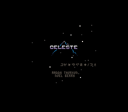
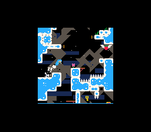

# snespico8

Run real PICO-8 cartridges on a stock, unmodified SNES.

snespico8 is the PICO-8 fantasy console rebuilt for real 16-bit hardware: the
z8lua interpreter and the full PICO-8 API in portable C, compiled for the
65816, with Mode 7 as a chunky 128x128 framebuffer and the SPC700 playing the
cart's music in real time while the game runs. It ships as a single flashable
`.sfc` — no special cartridge chip, just a Super Nintendo and its sound chip
doing what they were always capable of.

<p align="center">
  
  <br>
  <sub>Celeste Classic on a SNES — title and actual gameplay, 27&nbsp;KB of Lua
  interpreted by the console itself (in-game shot captured mid-playthrough in
  Mesen). More shots in <a href="docs/COMPATIBILITY.md">COMPATIBILITY.md</a>.</sub>
</p>

## Wait, what?

There is no CPU emulation here — PICO-8 carts are Lua source, so the SNES
runs them the way the desktop console does: by interpreting them.

- **A real Lua** (z8lua 5.2 with the PICO-8 dialect: fix32 numbers, `<<>`,
  `\`, all of it) compiled to the 65816 by Calypsi C, with the Lua heap
  living in cartridge SRAM (8 KB HiROM windows, probed at boot).
- **PICO-8's 64 KB machine RAM is WRAM bank $7F, byte for byte** — `peek`
  and `poke` are direct loads and stores.
- **Mode 7 as a framebuffer**: the only SNES mode with byte-per-pixel tiles,
  driven as a static 128x128 screen through a LUT expand + VRAM DMA.
- **The SPC700 is the audio chip, really**: the cart's SFX/music stream into
  APU RAM at load, and an autonomous sequencer plays them — in tune, with
  all eight note effects — in real time, whatever the game loop is doing.
- **`.p8` and `.p8.png` both work**: the PNG stego + pxa decode happens at
  build time on the host, so a cart export drops straight in.

How it all works, including the six documented Calypsi miscompiles and the
test net built around them: [docs/INTERNALS.md](docs/INTERNALS.md).

## How do we know it's correct?

The same core C sources build a host binary (`runp8`) and the SNES ROM. The
host side is pinned to a live z8lua oracle (149 printh vectors) and to real
PICO-8; the SNES side is then proven **bit-identical to the host** — printh
output, framebuffer hashes and machine-RAM hashes, per flip, across the
whole cart suite (`core-c/tests/snesparity.sh`). Codegen-sensitive changes
additionally pass a five-layout link-perturbation battery, listing-level
miscompile fences, a differential fuzzer (exhaustive where feasible: all
2^32 toint inputs), and on-target A/B tests for anything that touches
hardware math. This net has caught six compiler bugs and three latent core
bugs to date; none shipped.

## Try it

```
cd snes && make release      # -> build/snespico8.sfc  (the public demo ROM)
```

The public ROM bundles our own demo carts (graphics test, live joypad
readout, music demo) behind the cart menu — everything in it is freely
redistributable. To build a ROM around your own cart:

```
cd snes && make play PLAYCART=path/to/cart.p8    # or .p8.png
```

(Want Celeste? [docs/BUILDING.md](docs/BUILDING.md) has the two-command
recipe — fetch the cart, build, play. It stays on your machine: CC
licensing, see the doc.)

Add `P8BYTECODE=1` to any ROM target to precompile the cart's Lua on
your machine at build time and embed bytecode instead of source — the
console then skips its own parse (Celeste: ~65 s of boot becomes ~21 s,
and the parser's 40 KB working set never exists on the SNES). The
cross-compiler emits exactly the code the console's own compiler would,
and the test net holds the two paths bit-identical; see
[docs/BUILDING.md](docs/BUILDING.md) for the procedure and
[docs/INTERNALS.md](docs/INTERNALS.md) for how a 32-bit host compiles
for a 16-bit-int Lua.

Prerequisites (Calypsi, WLA-DX, Mesen for the test suites) and every make
target: [docs/BUILDING.md](docs/BUILDING.md).

## Docs

| doc | what |
|---|---|
| [docs/INTERNALS.md](docs/INTERNALS.md) | how a fantasy console runs on a 65816; the Calypsi minefield and its fences |
| [docs/COMPATIBILITY.md](docs/COMPATIBILITY.md) | what runs, how fast, API coverage, pinned edge semantics — with screenshots |
| [docs/PERF.md](docs/PERF.md) | where the time goes; the measurement rig; rules of the road |
| [docs/BUILDING.md](docs/BUILDING.md) | build the ROM + bring your own carts |
| [docs/FUTURE.md](docs/FUTURE.md) | polish backlog, real hardware, SA-1 |
| [docs/PROJECT.md](docs/PROJECT.md) | the original brief + the full milestone log |
| [docs/formats/](docs/formats/) | format notes: `.p8`/`.p8.png` cart decode, the SFX/music memory layout |
| [docs/M9-perf-plan.md](docs/M9-perf-plan.md) | the M9 perf log (analysis, tiers, results, the T7 addendum) |

## Built with AI, for fun

This project was built with AI assistance (Anthropic's Claude), as an
experiment in what a fantasy console and a 1990 game console can do
together. It is a hobby project, provided **AS IS**, without warranty of
any kind — if it bricks your flashcart, eats your save RAM, or offends
your compiler, that's the fun you signed up for. Bug reports and
real-hardware results are still very welcome.

## Legal & credits

Lua and z8lua are MIT ([zetalog/z8lua](https://github.com/samhocevar/z8lua));
our runtime and tools ship with source. PICO-8 is a trademark of Lexaloffle
Games — this project is an independent runtime and includes **no Lexaloffle
assets, carts, or code**; BBS carts are for local testing only and are never
redistributed. Calypsi C is free for personal use and is downloaded, never
redistributed. The font tables derive from fake-08 (MIT).
