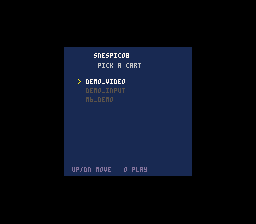
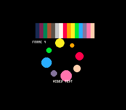
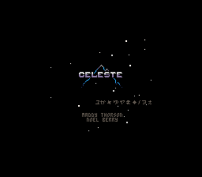
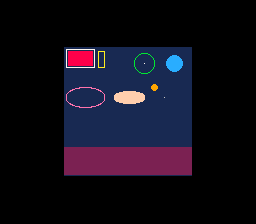
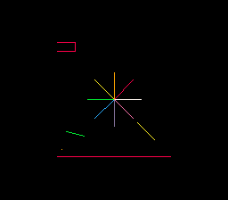
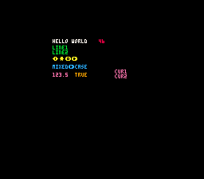
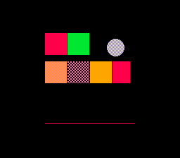
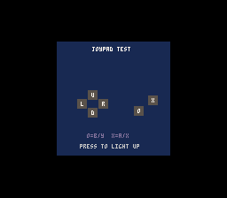

# What runs, and how fast

The runtime is a real Lua interpreter with the PICO-8 dialect and API — so
"does cart X run" is mostly "which APIs does it call" and "how fast is it",
not "does the CPU emulation cope".

## Gallery

Everything below is the actual SNES ROM rendering through Mode 7 in Mesen,
captured by the test harnesses (`make test-demo`, `make test-celeste`).

| | |
|---|---|
|  | **The cart menu** — the public demo ROM boots here; pick with the d-pad, O launches, Select returns. |
|  | **`demo_video.p8`** — the graphics test: the 16-color master palette, animated circles, `print`. |
|  | **Celeste Classic (evercore)** title screen — 27 KB of Lua parsed on-console, drawn by the real `_draw`. Cart © Maddy Thorson & Noel Berry (CC-BY-NC-SA), never bundled — build locally with `make test-celeste`. |
|  | **First light** (M0): the Mode 7 chunky-framebuffer spike that proved the whole display path before a line of Lua ran. |

And the M4 parity micro-carts — each of these renders **bit-identical to
the host oracle** (per-flip framebuffer + RAM hashes), which is the actual
test; the pictures are just proof of life
(captured with `snes/test/shot.lua`):

| | | |
|---|---|---|
|  |  |  |
| `gfx_shapes` — rect/circ/oval, outlines and fills, degenerate cases | `gfx_lines` — Bresenham in every octant + the line() continuation state | `gfx_print` — the 4px font, cursor mode, scroll |
|  |  | |
| `gfx_pal_fillp` — draw/screen palettes, `palt`, `fillp` dithers | `demo_input` — the live joypad readout from the demo ROM | |

## What boots and runs

- **The demo ROM** (`make -C snes demo-rom`): our own graphics test, live
  joypad readout, and music demo, behind the multi-cart menu. Everything in
  it is ours and freely shippable — this is the public release build.
- **`.p8` and `.p8.png` carts** embed at build time (`CART=path make p8`);
  the PNG stego + pxa decode happens on the host (`tools/p8png.py`), so
  both formats work anywhere.
- **Celeste Classic (evercore)** parses (27 KB of Lua, ~59 s), inits, and
  draws its title through Mode 7 with zero allocation failures on the
  256 KB SRAM heap (`make test-celeste`). It is a *demonstration of
  correctness*, not a way to play Celeste — see the honest part below.
- Real-time SPC audio: a cart's `music(0)` plays in tune, with all eight
  note effects, while the game loop crawls. This part is not slow-motion.
- Live controller input (d-pad, O = B/Y, X = A/X), `btnp` repeat, the
  Start pause menu with `menuitem()` callbacks, Select back to the menu.

## The performance picture (the honest part)

Frame rates on stock hardware after the M9 passes (see `docs/PERF.md`):

| cart class | today |
|------------|-------|
| menus / near-static API carts | ~5 fps ceiling, feels responsive |
| draw-bound carts (fills, shapes, text) | ~0.5–1 fps |
| sprite/map-heavy scenes | seconds per frame |
| VM-heavy gameplay (Celeste) | slow motion; a title flip in ~15 s of emulated time |

The audio is always real time — that contrast (game in slow motion, music
perfect) is the project's signature, not a bug.

## API coverage

Implemented and oracle-pinned: the fix32 number tower and every dialect
operator (54 numvec + 27 dialect vectors against live z8lua), the drawing
API (cls/pset/pget/line/rect/rectfill/circ/circfill/oval/ovalfill/spr/sspr/
map/mget/mset/sget/sset/fget/fset/pal/palt/fillp/camera/clip/color/cursor/
print with scroll), tables/strings/coroutines (`all`, `foreach`, `add`,
`del`, `cocreate` aliases...), `peek/poke` over the full 64 KB, input
(`btn`/`btnp`), `sfx`/`music` (routed to the SPC), `stat` essentials,
`menuitem`, deterministic `rnd`/`srand`, `time`/`t`.

Stubbed as no-ops: `cstore`, `reload`, `extcmd`, and the other
console/editor-facing calls (tagged in `p8gfx.c`/`p8.c`).

Not there: P8SCII control codes in `print`, `tline`, serial/GPIO, the
0.2.4+ extended RAM behaviors beyond plain peek/poke.

## Pinned edge semantics (the fine print)

Divergences and dark corners are pinned by test vectors, not folklore:

- Shift counts floor the fix32 operand and negate **as an int** —
  `16 << -1.5` is 4, `x << -32768` is 0 (the pre-M9 code hung on the
  latter; on hardware that was a stack overflow reachable from any cart).
- `x / 0` saturates (`0x7fff.ffff` / `0x8000.0000` by sign), `x % 0 = 0`.
- Decimal fraction literals truncate at 6 digits like the real console
  (z8lua rounds; we follow PICO-8, pinned by `tostr(x,1)` dumps).
- `sin`/`cos` at the fix32 extremes overshoot to ±1.1055 exactly as z8lua
  does on clang and on the 65816 — gcc hosts round differently, which is
  why libvec is a local gate, not a CI gate.
- Draw state is snapshotted per shape call (camera/clip/fillp/palette);
  this is observationally identical to per-pixel reads because nothing can
  mutate draw state mid-shape.
- `rnd`/`srand` match real PICO-8 draws byte-for-byte on seeded streams
  (see INTERNALS.md); the raw state words at $5F44/$5F48 are held in a
  different-but-equivalent arrangement.
- Debug hooks are compiled out of the SNES build (the per-op hookmask
  test was measurable VM overhead): `debug.sethook` sets state the VM
  never reads, so hooks silently never fire. Real PICO-8 exposes no
  hook path at all, so no cart can observe the difference.
- One genuinely open corner: `tostr`'s 4-decimal display boundary. Real
  PICO-8's evidence is contradictory at the edges (raw `0xffff` displays
  as "1", demanding rounding; raw `6` displays as "0", demanding
  truncation) — no single rule fits both. We round half-up like z8lua.
  Display-only, 1-ulp class; the test vectors compare raw bits and
  sidestep it.

## Memory

PICO-8 RAM is bank $7F, 1:1. The Lua heap is 12 KB of WRAM plus every
SRAM window that answers a boot-time probe — 256 KB on the target flashcart
profile, ~100 KB peak for Celeste. `stat(0)` reports heap use; allocation
failure raises a Lua "out of memory" error instead of corrupting.

## Help wanted

Cart reports welcome: anything that parses but draws wrong is a real bug
(the gfx suite is bit-exact against the host oracle, so a divergence means
a missing API or a genuine hole, not "close enough"). Anything slower than
the table above says is expected — M9 T6 (the VM split) and M11 (SA-1) are
the speed roadmap.
